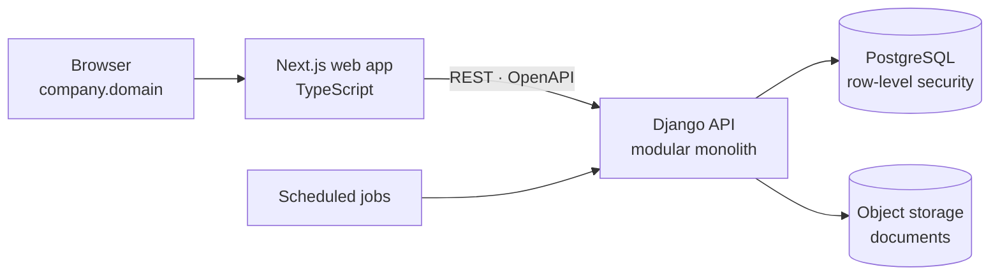

# ZAMHRMS

**HR and payroll for Zambian businesses**, built by [Insight Analytics](https://insightanalyticsltd.com).

> The source code is private because this is a commercial product. This repository explains
> what the system does, how it is built, and how the work is progressing. I'm happy to walk
> through the code itself in an interview.

**Status:** in active development. All backend modules are complete; the web app is being
filled in feature by feature. The pilot runs on synthetic data only.
*Last updated: October 2026.*

## What it does

| Area | What's in it |
|---|---|
| **Employees** | Records, departments and reporting lines. National Registration Card (NRC) numbers are encrypted at rest. |
| **Attendance** | Shifts, shift assignments, clocking in and out |
| **Leave** | Statutory leave types under Zambian employment law, versioned entitlement rules, multi-step approval chains |
| **Recruitment and onboarding** | Requisitions, candidates and offers. A hire creates the employee, salary and shift together. |
| **Payroll** | PAYE, NAPSA and NHIMA calculations, payroll runs, payslips, and corrections that need a second person to approve |
| **Data protection** | Subject access and erasure requests under Zambia's Data Protection Act, plus an append-only audit trail |
| **Sign-in** | Password, passkeys and Google sign-in. Each company works on its own subdomain. |

## Architecture

The backend is a **modular monolith**: one deployable service, with each HR domain
(employees, attendance, leave, recruitment, payroll) in its own module. Modules depend on
each other only through small typed interfaces (Python `Protocol`s), so each one can be
built and tested against a fake of the others. If one ever needs to become its own
service, the boundary already exists.

## Engineering decisions

**1. Tenant isolation lives in the database, not in application code.**
Every company's data sits in shared tables, and every table has a PostgreSQL row-level
security policy. Each request sets its tenant inside its own transaction. The application
connects as a database role that can neither bypass those policies nor owns the tables.
A test confirms that a session with no tenant set sees zero rows across every table.
*Why:* if isolation depends on every query remembering a `WHERE company_id = …`, one
forgotten clause leaks one company's payroll to another. With row-level security, the
database refuses the read even when the code forgets.

**2. The tenant comes from the subdomain, before anyone signs in.**
`acme.<domain>` is resolved to a tenant first, and only then are credentials checked.
*Why:* the same email address can belong to people at two different companies. Also, the
API framework authenticates late in the request cycle, so a tenant taken from the signed-in
user would not be set early enough for every query.

**3. Hiring happens in one transaction.**
Creating the employee, their salary record and their shift either all succeed or none do.
*Why:* a half-hired employee, with a record but no salary, would silently break the next
payroll run.

**4. Statutory rates are data, not constants.**
Tax bands and contribution rates are stored with effective dates and a source reference,
because they change with every national budget. Each rule also carries a confidence level:
*settled* (read from the Act), *corroborated* (independent sources agree), or *disputed*.
By default only settled rules are used to set up a company's leave and pay rules.

**5. Retries can't double-apply.**
State-changing requests carry an idempotency key, and each key is claimed atomically in
PostgreSQL (`INSERT … ON CONFLICT DO NOTHING`). *Why:* on a weak mobile connection, a user
who taps "hire" or "approve" twice, or a client that retries after a timeout, must not
hire twice or pay twice. Because the claim happens in the database, this still holds when
several API instances run side by side.

**6. Encrypted national IDs that can still be searched.**
NRC numbers are encrypted with AES-256-GCM. A separate HMAC "blind index" lets the system
find an employee by NRC without decrypting the whole table. Every stored value carries a
version prefix, so keys can be rotated later.

**7. A decision I reversed.**
The backend started in Go. When I became the only engineer on the project, I moved it to
Django, the stack I work fastest and most safely in. The architecture document records
the trade-off. The database schema didn't change at all: it is plain SQL, so all of the
migrations carried over untouched.

## A bug worth telling

At one point every test passed, yet on a real server every signed-in request saw an empty
database. The tenant setting is scoped to a database transaction, and the test framework
wraps each test in one, so the setting "stuck" in tests but vanished in production before
the view ran. Only running the real server exposed it. The fix sets the tenant inside the
request's own transaction.

*The lesson I took:* a test suite can pass for the wrong reason, and nothing counts until
it has run the way production runs it.

## Quality and process

- **872 automated tests** (578 backend, 294 frontend) as of October 2026
- **CI on every pull request:**
  - backend: linting and formatting (ruff), static type checks (mypy), and tests against
    real PostgreSQL and object storage
  - frontend: linting, type checks, unit tests and a production build
  - guard checks that fail the build if the tenant-isolation tests silently stop running
- **Security checks:** secret scanning of the full git history (gitleaks), and
  dependency vulnerability audits (pip-audit, npm audit)
- **One API contract:** the API is described in OpenAPI, the frontend's types are
  generated from it, and a test fails if the two drift apart
- **How the work is done:**
  - every change lands through a pull request
  - commit messages follow the Conventional Commits format
  - written design documents (architecture, database, development guide, requirements)
    govern the build

## Stack

| Layer | Technology |
|---|---|
| Backend | Python 3.13, Django 5.2 LTS, Django REST Framework |
| Database | PostgreSQL with row-level security, audit triggers, SQL migrations |
| Frontend | Next.js, TypeScript, CSS modules |
| Storage | S3-compatible object storage |
| Delivery | Docker, GitHub Actions, Render |

## Build log

| When | What landed |
|---|---|
| **Oct 2026** | Hiring with salary in one step · payroll runs end to end with safe corrections · adding and editing employees in the web app · demo deployment |
| **Late Sep 2026** | Passkeys and Google sign-in · a seeded demo workspace · the full web app frame · dashboards for HR, managers and employees · OpenAPI schema and generated types · scheduled jobs and health checks |
| **Mid Sep 2026** | Backend rebuilt in Django · idempotency · the employee, attendance, leave, recruitment, document storage, data-protection and payroll modules |
| **Early Sep 2026** | The database: identity tables with enforced tenant isolation, an append-only audit trail, and the complete schema |

**Next:** employees withdrawing their own leave requests, then user and role management,
documents, reports and analytics, and performance reviews.
